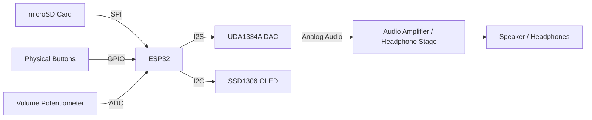
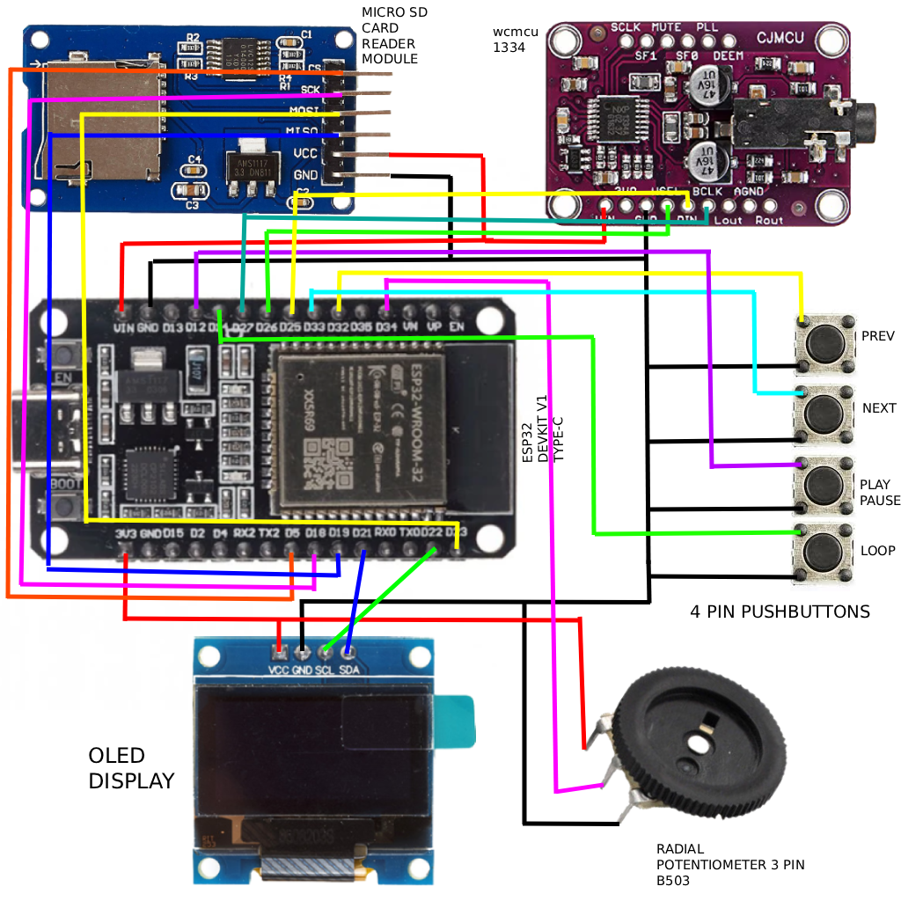
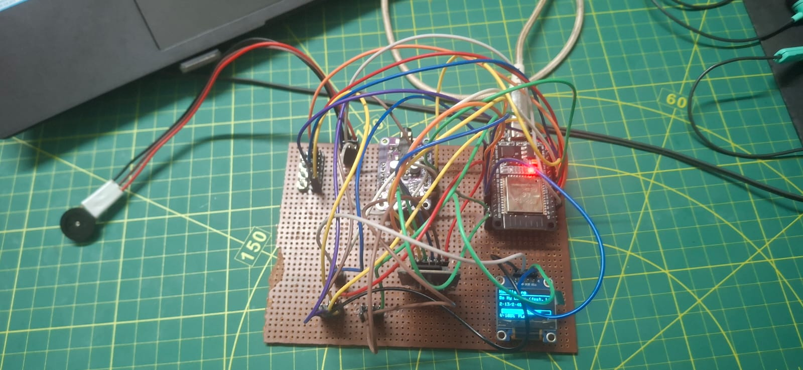
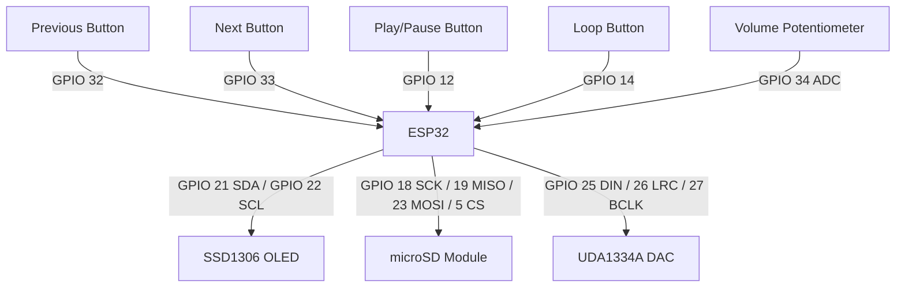
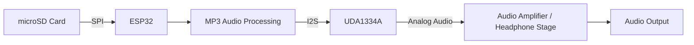
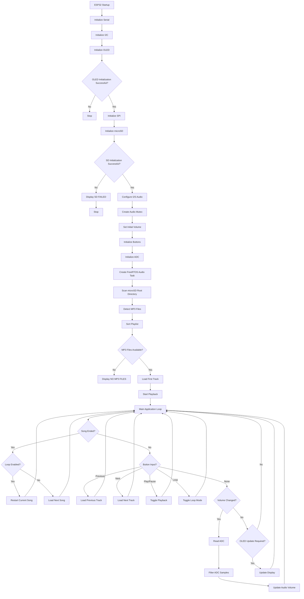
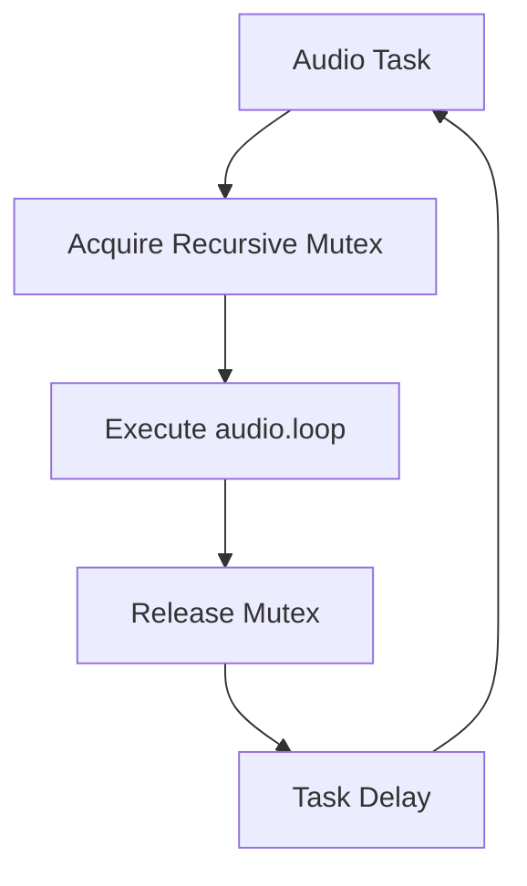

# OPEN-SOURCE ESP-32 UDA1334A MUSIC PLAYER

## 1. Project Overview

The **Open-Source ESP-32 UDA1334A Music Player** is a standalone digital audio player based on the ESP32 microcontroller platform.

The system is designed to read MP3 audio files from a microSD card, process the audio using the ESP32, and transmit the resulting digital audio stream through an I²S interface to a UDA1334A digital-to-analog converter (DAC).

A 128×64 SSD1306 OLED display provides playback information. Four physical push buttons provide playback controls, and an analog potentiometer provides hardware volume control.

The project is released as an open-source hardware and firmware reference implementation intended to allow developers and hobbyists to build, modify, extend, and develop their own ESP32-based music players.

The current repository represents a **Test Alpha build**. The implementation is functional and has been tested as a working MP3 player, but the firmware has not yet undergone sufficient testing to be considered a stable or production-ready release.

---

## 2. Project Objectives

The primary objectives of this project are:

* Implement a standalone MP3 player using an ESP32.
* Provide local audio storage using a microSD card.
* Use an external UDA1334A I²S DAC for digital-to-analog audio conversion.
* Provide physical controls for common playback operations.
* Provide a simple OLED-based playback interface.
* Implement software-based playlist management.
* Provide a reproducible hardware and software configuration.
* Release the implementation as open-source software for further development.
* Provide a practical reference for ESP32-based embedded audio development.

---

## 3. Current Development Status

### Release Status

**Test Alpha**

The current hardware and firmware implementation has been assembled and tested as a functional MP3 player.

The following functions are currently implemented:

* MP3 file detection from microSD storage
* MP3 file loading
* Playlist generation
* Alphabetical playlist sorting
* MP3 playback
* Play/pause
* Previous track
* Next track
* Loop mode
* Hardware volume control
* Playback time display
* Playback duration display
* Playback progress display
* OLED status display
* I²S audio output
* FreeRTOS audio task
* Recursive mutex protection for audio operations
* Button debouncing
* ADC filtering for volume control

The system remains under development.

The current Alpha implementation may exhibit issues related to:

* Audio output stability
* Audio buffer underruns
* Audio memory utilization
* Memory fragmentation
* SD card read performance
* MP3 decoding behavior
* Peripheral compatibility
* Long-duration playback
* Different MP3 encoding configurations

These limitations should be considered before using the project in a production device.

---

## 4. System Architecture

The system consists of the following major subsystems:

1. ESP32 controller
2. microSD storage interface
3. SSD1306 OLED display
4. UDA1334A I²S DAC
5. Physical button interface
6. Analog volume control
7. Downstream audio amplification/output stage

The general system architecture is:



The ESP32 acts as the central controller.

The microSD card provides local storage for MP3 files. The ESP32 reads the selected file, processes the audio using the configured audio library, and sends the digital audio stream to the UDA1334A through I²S.

The UDA1334A converts the digital audio stream to an analog signal. A suitable downstream amplifier or headphone stage is required for driving the final audio output device.

---

## 5. Hardware Components

### 5.1 Required Components

| Component                                      |    Quantity | Function                           |
| ---------------------------------------------- | ----------: | ---------------------------------- |
| ESP32 development board                        |           1 | Main microcontroller               |
| UDA1334A I²S DAC                               |           1 | Digital-to-analog audio conversion |
| microSD card module                            |           1 | SD storage interface               |
| microSD card                                   |           1 | MP3 storage                        |
| SSD1306 128×64 OLED                            |           1 | User interface                     |
| Momentary push buttons                         |           4 | Playback controls                  |
| 10 kΩ potentiometer                            |           1 | Volume control                     |
| Audio amplifier or suitable audio output stage |           1 | Audio amplification                |
| Connecting wires                               | As required | Electrical connections             |
| Breadboard or PCB                              |    Optional | Hardware assembly                  |

### 5.2 Optional Components

The following components may be added depending on the intended final implementation:

* Headphone amplifier
* Speaker amplifier
* Speakers
* Rotary encoder
* Battery
* Battery charging circuit
* Voltage regulation circuitry
* Custom PCB
* Enclosure

The current firmware does not require these optional components.

---

## 6. Hardware Implementation

The following images document the current Test Alpha hardware implementation.

### 6.1 Hardware Pinout

The following diagram shows the GPIO assignments and peripheral connections used by the current firmware.



---

### 6.2 Working Prototype

The following photographs show the assembled prototype during operation.




These photographs represent the current Alpha hardware revision. The physical implementation may change during subsequent development.

---

## 7. ESP32 Pin Configuration

The following GPIO assignments correspond to the current Alpha firmware.

### 7.1 SSD1306 OLED

| OLED Signal | ESP32 GPIO | Interface |
| ----------- | ---------: | --------- |
| SDA         |    GPIO 21 | I²C       |
| SCL         |    GPIO 22 | I²C       |

The firmware initializes the I²C interface using:

```cpp
Wire.begin(21, 22);
Wire.setClock(400000);
```

The configured OLED address is:

```text
0x3C
```

---

### 7.2 microSD Card

The microSD card is connected using SPI.

| SD Signal | ESP32 GPIO | Interface |
| --------- | ---------: | --------- |
| CS        |     GPIO 5 | SPI       |
| MOSI      |    GPIO 23 | SPI       |
| MISO      |    GPIO 19 | SPI       |
| SCK       |    GPIO 18 | SPI       |

The firmware initializes SPI using:

```cpp
SPI.begin(SPI_SCK, SPI_MISO, SPI_MOSI);
```

The chip-select pin is:

```cpp
#define SD_CS 5
```

---

### 7.3 UDA1334A I²S DAC

| DAC Signal | ESP32 GPIO | Function         |
| ---------- | ---------: | ---------------- |
| DIN        |    GPIO 25 | I²S data         |
| LRC / WS   |    GPIO 26 | Left/right clock |
| BCLK       |    GPIO 27 | Bit clock        |

The firmware defines:

```cpp
#define I2S_DOUT 25
#define I2S_BCLK 27
#define I2S_LRC 26
```

The audio interface is configured using:

```cpp
audio.setPinout(I2S_BCLK, I2S_LRC, I2S_DOUT);
```

The ESP32-audioI2S project documents I²S audio output and support for the UDA1334A DAC.

---

### 7.4 Push Buttons

All four buttons use the ESP32 internal pull-up configuration.

| Function   | ESP32 GPIO |
| ---------- | ---------: |
| Previous   |    GPIO 32 |
| Next       |    GPIO 33 |
| Play/Pause |    GPIO 12 |
| Loop       |    GPIO 14 |

Each button is connected between the corresponding GPIO and ground.

The firmware uses:

```cpp
pinMode(BTN_PREV, INPUT_PULLUP);
pinMode(BTN_NEXT, INPUT_PULLUP);
pinMode(BTN_PLAY, INPUT_PULLUP);
pinMode(BTN_LOOP, INPUT_PULLUP);
```

The resulting button states are:

```text
Released = HIGH
Pressed  = LOW
```

The firmware also implements software debouncing.

---

### 7.5 Volume Potentiometer

The potentiometer wiper is connected to:

```text
GPIO 34
```

The firmware uses the ESP32 ADC with 12-bit resolution:

```cpp
analogReadResolution(12);
```

The ADC range is:

```text
0–4095
```

The firmware maps this range to:

```text
0–100%
```

The potentiometer is sampled repeatedly and the readings are averaged using an eight-sample buffer to reduce short-term ADC fluctuations.

---

## 8. Hardware-to-Firmware Interface

The complete peripheral interface can be represented as follows:



Power and ground connections are omitted from the GPIO documentation above.

---

## 9. Audio Data Flow

The audio data path is:



The ESP32 reads the MP3 file from the microSD card and processes the audio using the configured audio library.

The resulting digital audio stream is transmitted through I²S.

The UDA1334A performs the digital-to-analog conversion.

The resulting analog audio signal is then intended for a suitable downstream audio stage.

The UDA1334A should not be treated as a speaker power amplifier. Passive speakers generally require an additional amplification stage.

---

## 10. Firmware Execution Flow

The primary firmware execution sequence is:



---

## 11. FreeRTOS Audio Architecture

The firmware creates a dedicated FreeRTOS task for continuous audio processing.

The audio task repeatedly executes:

```cpp
audio.loop();
```

The task is created using:

```cpp
xTaskCreatePinnedToCore(
    audioTask,
    "audioTask",
    16384,
    NULL,
    2,
    NULL,
    0
);
```

Audio access is protected using a recursive mutex:

```cpp
SemaphoreHandle_t audioMutex;
```

The general task operation is:



The mutex is also used when the main application performs operations such as:

* Starting a song
* Stopping a song
* Changing volume
* Reading playback time
* Reading track duration
* Restarting playback

This architecture was introduced during development to prevent concurrent access to the audio subsystem.

---

## 12. Software Architecture

The firmware is written in C++ using the Arduino ESP32 framework.

The implementation is divided into several functional areas.

### 12.1 Audio Processing

The `Audio` object provided by ESP32-audioI2S is responsible for MP3 processing and I²S output.

### 12.2 Storage

The following interfaces are used for microSD access:

```cpp
FS.h
SD.h
SPI.h
```

The firmware scans the root directory and identifies files with the `.mp3` extension.

### 12.3 User Interface

The OLED is controlled through:

```cpp
Wire.h
Adafruit_GFX
Adafruit_SSD1306
```

### 12.4 Button Handling

The button system implements:

* Internal pull-up configuration
* State tracking
* Debouncing
* Press-edge detection

### 12.5 Volume Control

The potentiometer is read through the ESP32 ADC.

Eight readings are maintained in a circular buffer and averaged before the resulting value is converted into a software volume value.

### 12.6 Playlist Management

The current firmware supports up to 50 MP3 files.

Detected files are stored in a fixed-size playlist array and sorted alphabetically before playback.

---

## 13. Software Requirements

The current Alpha build uses the following tested dependency versions.

| Dependency           |           Version | Status    |
| -------------------- | ----------------: | --------- |
| Arduino-ESP32        |        **2.0.17** | Tested    |
| ESP32-audioI2S       |         **2.0.0** | Tested    |
| Adafruit GFX Library | Latest compatible | Supported |
| Adafruit SSD1306     | Latest compatible | Supported |

The two primary dependencies are intentionally pinned.

Newer releases should not be assumed to be compatible with this Alpha firmware without testing.

Arduino-ESP32 has subsequently moved to the 3.x series, which introduced API changes from the 2.x series. The project therefore retains version 2.0.17 as the tested Alpha environment.

---

## 14. ESP32-audioI2S

This project uses:

**ESP32-audioI2S — Version 2.0.0**

Repository:

https://github.com/schreibfaul1/ESP32-audioI2S

The library provides the audio processing and I²S output functionality used by this project.

The UDA1334A is among the supported I²S DAC configurations documented by the upstream project.

### Dependency Version Policy

Version **2.0.0** is the tested version for this Alpha release.

The upstream library continues to receive development beyond the version used here. Updating the library may introduce API, behavior, memory, or compatibility differences.

Any dependency upgrade should therefore be accompanied by regression testing of:

* MP3 decoding
* I²S output
* Track transitions
* Playback stability
* Memory usage
* SD card access
* Volume control

---

## 15. Arduino-ESP32

This project uses:

**Arduino-ESP32 — Version 2.0.17**

Repository:

https://github.com/espressif/arduino-esp32

Version 2.0.17 is the tested ESP32 Arduino environment for this Alpha release.

The project is not currently validated against the Arduino-ESP32 3.x API. Changes between major versions may require firmware modifications.

---

## 16. Installation

### 16.1 Arduino IDE

Install a compatible Arduino IDE version.

Install the ESP32 board package through the Arduino Board Manager.

Select:

```text
ESP32 Arduino Core 2.0.17
```

Select the ESP32 development board corresponding to the hardware being used.

---

### 16.2 Required Libraries

Install:

```text
ESP32-audioI2S 2.0.0
Adafruit GFX Library
Adafruit SSD1306
```

The following libraries are provided through the ESP32 Arduino environment or standard Arduino-compatible interfaces:

```cpp
Arduino.h
FS.h
SD.h
SPI.h
Wire.h
```

---

### 16.3 Firmware

Open:

```text
PLAYER_VER_0_1.ino
```

in the Arduino IDE.

Verify the selected board and ESP32 core version.

Compile the firmware and upload it to the ESP32.

---

## 17. microSD Card Configuration

The firmware scans the root directory of the microSD card for MP3 files.

Example:

```text
/
├── TRACK01.mp3
├── TRACK02.mp3
├── TRACK03.mp3
├── TRACK04.mp3
└── ...
```

Only files with the `.mp3` extension are added to the playlist.

File extension matching is case-insensitive.

The current firmware supports a maximum of:

```text
50 tracks
```

The playlist is sorted alphabetically before playback begins.

Folder-based playlist management is not currently implemented.

---

## 18. User Controls

| Control              | Function               |
| -------------------- | ---------------------- |
| Previous button      | Select previous track  |
| Next button          | Select next track      |
| Play/Pause button    | Toggle playback        |
| Loop button          | Toggle loop mode       |
| Volume potentiometer | Adjust playback volume |

### Playback Behavior

When loop mode is disabled:

```text
Current track ends
        ↓
Next track selected
        ↓
Playback begins
```

When loop mode is enabled:

```text
Current track ends
        ↓
Current track restarted
```

---

## 19. OLED Interface

The SSD1306 OLED displays:

* Current track
* Playback time
* Total track duration
* Playback progress
* Current volume
* Playback state
* Loop state
* Playlist position

The display is periodically updated rather than continuously refreshed.

The current implementation limits display updates to reduce unnecessary processing and I²C activity.

---

## 20. Audio Output

The audio path is:

```text
microSD
   |
   | SPI
   v
ESP32
   |
   | I²S
   v
UDA1334A
   |
   | Analog Audio
   v
Amplifier / Headphone Stage
   |
   v
Audio Output
```

The UDA1334A performs digital-to-analog conversion.

The DAC should be connected to an appropriate downstream audio stage according to the requirements of the intended output device.

The UDA1334A should not be considered a power amplifier for directly driving conventional passive speakers.

---

## 21. Memory and Audio Buffer Considerations

The current project is an Alpha implementation and has not been exhaustively tested under all possible audio and memory conditions.

Audio processing requires continuous access to CPU time and memory.

Potential factors affecting playback stability include:

* MP3 bitrate
* MP3 sample rate
* MP3 encoding parameters
* File size
* SD card read speed
* SD card latency
* Available heap memory
* Memory fragmentation
* Playlist size
* Continuous playback duration
* ESP32 board variant
* Library version

Potential symptoms include:

* Audio interruptions
* Buffer underruns
* Playback stopping
* Audio output instability
* Unexpected resets
* Watchdog events
* Memory allocation failures

These conditions are part of the current Alpha testing scope.

---

## 22. Known Limitations

The current implementation has the following limitations:

* Maximum playlist size is 50 tracks.
* MP3 files are currently detected from the SD card root directory.
* Folder-based music organization is not implemented.
* Album artwork is not implemented.
* Advanced metadata display is not implemented.
* Shuffle mode is not implemented.
* Resume playback is not implemented.
* Additional audio formats have not been implemented.
* Extensive hardware compatibility testing has not been completed.
* Audio buffer behavior requires further testing.
* Memory utilization requires further optimization.
* Newer versions of the primary dependencies have not been validated.

---

## 23. Alpha Testing Status

The current hardware has been tested as a functional MP3 player.

The repository contains photographs documenting the working prototype:

* `screenshots/live working.jpeg`
* `screenshots/working_live.jpeg`

The hardware pin configuration is documented in:

* `screenshots/pinout_LABELED.png`

These files are intended to provide a visual reference for the current Alpha implementation.

The images do not constitute a finalized hardware design or PCB specification.

---

## 24. Troubleshooting

### 24.1 OLED Does Not Initialize

Verify:

```text
OLED SDA → GPIO 21
OLED SCL → GPIO 22
```

The firmware expects:

```text
I²C Address = 0x3C
```

---

### 24.2 SD Card Initialization Failure

Verify:

```text
SD CS   → GPIO 5
SD MOSI → GPIO 23
SD MISO → GPIO 19
SD SCK  → GPIO 18
```

Verify that the SD card can be read correctly and that MP3 files are present in the root directory.

---

### 24.3 No Audio Output

Verify:

```text
UDA1334A DIN  → GPIO 25
UDA1334A LRC  → GPIO 26
UDA1334A BCLK → GPIO 27
```

Also verify the connection between the DAC's analog output and the downstream amplifier or headphone stage.

---

### 24.4 Audio Interruptions

Possible causes include:

* SD card latency
* Insufficient buffering
* Memory pressure
* MP3 encoding characteristics
* CPU contention
* Incorrect library versions
* Hardware signal integrity issues

The first step should be to verify that the tested dependency versions are being used:

```text
Arduino-ESP32 = 2.0.17
ESP32-audioI2S = 2.0.0
```

---

### 24.5 Unexpected Resets

Check:

* Available memory
* Power stability
* SD card behavior
* Audio buffer behavior
* Serial Monitor output
* ESP32 board configuration
* Peripheral wiring

When reporting an issue, include the serial output whenever possible.

---

## 25. Development and Testing

The project has undergone iterative development involving:

* ESP32 firmware development
* SD card integration
* MP3 playback implementation
* I²S DAC integration
* OLED integration
* Button input handling
* ADC volume control
* FreeRTOS task management
* Audio mutex handling
* Playback state management
* Memory and buffering investigation
* Hardware debugging
* Dependency compatibility testing

The current repository represents the working Alpha state resulting from this development process.

Further testing is required before a stable release can be defined.

---

## 26. Bug Reports

When reporting a problem, provide as much of the following information as possible:

```text
ESP32 board:
Arduino-ESP32 version:
ESP32-audioI2S version:
SD card capacity:
SD card filesystem:
MP3 bitrate:
MP3 sample rate:
MP3 file size:
Approximate playback duration before failure:
Problem description:
Serial Monitor output:
```

For hardware-related issues, also provide a photograph or wiring diagram where possible.

---

## 27. Development Roadmap

Potential future development includes:

* Improved audio buffering
* Memory optimization
* Improved SD card error handling
* Improved playback recovery
* Folder and directory support
* ID3 metadata support
* Artist and album information
* Album artwork
* Shuffle playback
* Resume playback
* Additional audio format support
* Improved OLED interface
* Rotary encoder support
* Battery-powered operation
* Power management
* Custom PCB development
* Enclosure development
* Expanded hardware compatibility testing
* Long-duration playback testing
* Stable release

The roadmap is subject to change as testing and development continue.

---

## 28. Open-Source Development

The firmware is released publicly to allow developers to study, modify, test, and extend the implementation.

The project is intended to serve as a foundation for custom ESP32-based music players and embedded audio systems.

Potential contributions include:

* Bug fixes
* Audio stability improvements
* Memory optimization
* Hardware compatibility testing
* Documentation improvements
* Additional peripherals
* User-interface improvements
* Additional playback functionality
* Alternative hardware configurations

Contributions affecting the audio subsystem, task scheduling, memory management, or dependency versions should include appropriate testing information.

---

## 29. Developer

**Developed by:** Shubhayu Kundu

**GitHub:** https://github.com/Shubhayu15

The project was developed as an independent hardware and firmware implementation with emphasis on practical ESP32 audio development and open-source distribution.

---

## 30. Third-Party Dependencies

This project uses third-party open-source libraries.

### ESP32-audioI2S

Repository:

https://github.com/schreibfaul1/ESP32-audioI2S

Tested version:

```text
2.0.0
```

ESP32-audioI2S provides the audio processing and I²S functionality used by this project. The upstream project documents support for I²S DAC configurations including the UDA1334A.

Refer to the upstream repository for the complete license and terms applicable to the dependency.

### Arduino-ESP32

Repository:

https://github.com/espressif/arduino-esp32

Tested version:

```text
2.0.17
```

Arduino-ESP32 provides the Arduino framework and hardware support layer used by the ESP32 firmware.

Refer to the upstream repository for the complete license and terms applicable to the dependency.

### Adafruit GFX

The project uses the Adafruit GFX graphics library for display rendering.

### Adafruit SSD1306

The project uses the Adafruit SSD1306 library for communication with the SSD1306 OLED display.

The licenses and terms of the respective third-party libraries apply to those components.

---

## 31. Dependency Compatibility Policy

For reproducibility of the current Alpha release, the following versions should be used:

| Component        |    Tested Version |
| ---------------- | ----------------: |
| Arduino-ESP32    |        **2.0.17** |
| ESP32-audioI2S   |         **2.0.0** |
| Adafruit GFX     | Latest compatible |
| Adafruit SSD1306 | Latest compatible |

The two primary dependencies are intentionally pinned.

Using newer versions may be possible, but such configurations are considered untested until the complete playback pipeline has been verified.

Testing should include:

* Firmware compilation
* SD card initialization
* MP3 file loading
* Playback
* Track transitions
* Play/pause
* Loop operation
* Volume control
* OLED operation
* Long-duration playback
* Memory behavior
* I²S output stability

---

## 32. Project Status Summary

| Subsystem                      | Status            |
| ------------------------------ | ----------------- |
| ESP32 controller               | Functional        |
| microSD interface              | Functional        |
| MP3 file detection             | Functional        |
| Playlist generation            | Functional        |
| Playlist sorting               | Functional        |
| MP3 playback                   | Functional        |
| I²S output                     | Functional        |
| UDA1334A integration           | Functional        |
| OLED interface                 | Functional        |
| Previous/Next controls         | Functional        |
| Play/Pause control             | Functional        |
| Loop mode                      | Functional        |
| Volume control                 | Functional        |
| FreeRTOS audio task            | Implemented       |
| Audio mutex                    | Implemented       |
| Memory optimization            | Under development |
| Buffer stability testing       | Under development |
| Hardware compatibility testing | Under development |
| Production readiness           | Not established   |

---

## 33. License

This repository is intended to be distributed as an open-source project.

A dedicated `LICENSE` file should be included in the repository specifying the license selected for the original project source code.

Third-party dependencies retain their respective licenses and terms.

Users and contributors should review the licenses of all included dependencies before redistributing modified versions of the project.

---

## 34. Disclaimer

This repository contains a Test Alpha implementation.

The hardware and firmware have not undergone the level of validation required for a production commercial audio device.

Users are responsible for verifying:

* Electrical compatibility
* Correct power requirements
* GPIO connections
* DAC configuration
* Amplifier compatibility
* SD card compatibility
* Hardware stability
* Firmware compatibility

The project may contain unresolved software or hardware issues.

The Alpha release should therefore be considered an experimental development platform rather than a finished consumer product.

---

## 35. Repository Structure

The current repository is organized as follows:

```text
OPEN-SOURCE-ESP32-UDA1334A-MUSIC-PLAYER/
│
├── screenshots/
│   ├── live working.jpeg
│   ├── working_live.jpeg
│   └── pinout_LABELED.png
│
├── PLAYER_VER_0_1.ino
│
└── readme.md
```

### File Description

| File / Directory     | Description                                 |
| -------------------- | ------------------------------------------- |
| `PLAYER_VER_0_1.ino` | Current Alpha firmware                      |
| `screenshots/`       | Prototype and hardware documentation images |
| `pinout_LABELED.png` | ESP32 peripheral pinout                     |
| `live working.jpeg`  | Working prototype photograph                |
| `working_live.jpeg`  | Working prototype photograph                |
| `readme.md`          | Project documentation                       |

---

## 36. Current Alpha Configuration

```text
Project:
OPEN-SOURCE ESP-32 UDA1334A MUSIC PLAYER

Platform:
ESP32

Firmware Framework:
Arduino ESP32

Arduino-ESP32:
2.0.17

ESP32-audioI2S:
2.0.0

Audio Interface:
I²S

DAC:
UDA1334A

Storage:
microSD

Display:
SSD1306 128×64 OLED

Playlist Limit:
50 MP3 files

Audio Controls:
Previous
Next
Play/Pause
Loop
Volume

Development Status:
Test Alpha
```

---

## 37. Conclusion

The Open-Source ESP-32 UDA1334A Music Player provides a functional starting point for developing standalone ESP32-based digital audio systems.

The current Test Alpha demonstrates the integration of microSD storage, MP3 playback, I²S digital audio, UDA1334A digital-to-analog conversion, OLED-based status reporting, physical playback controls, analog volume control, and FreeRTOS-based audio processing.

The implementation is intentionally released during development so that further testing, debugging, optimization, and feature development can be performed collaboratively.

The current release should be treated as an experimental Alpha platform. Future revisions are expected to improve audio stability, memory management, hardware compatibility, user-interface functionality, and overall system robustness.
